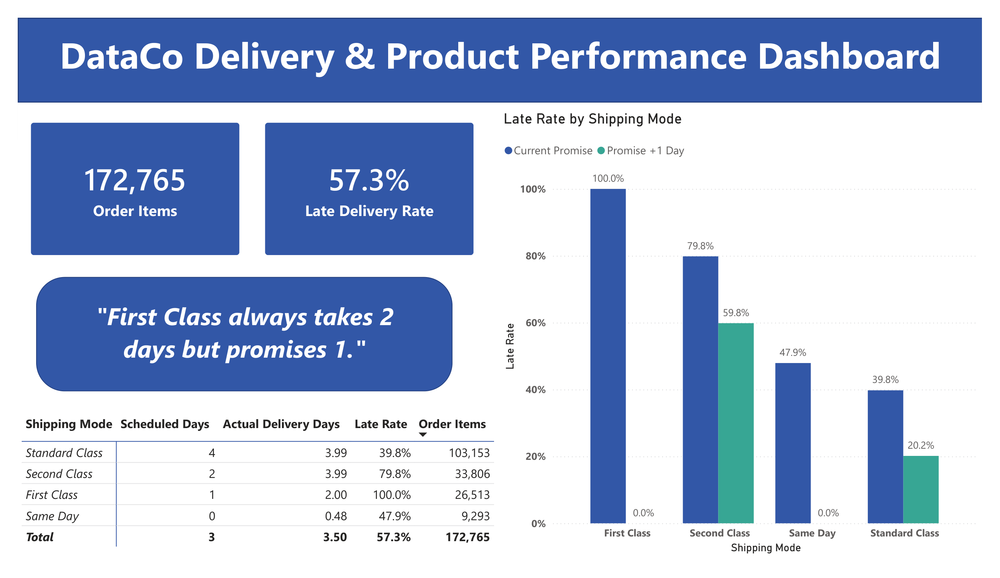
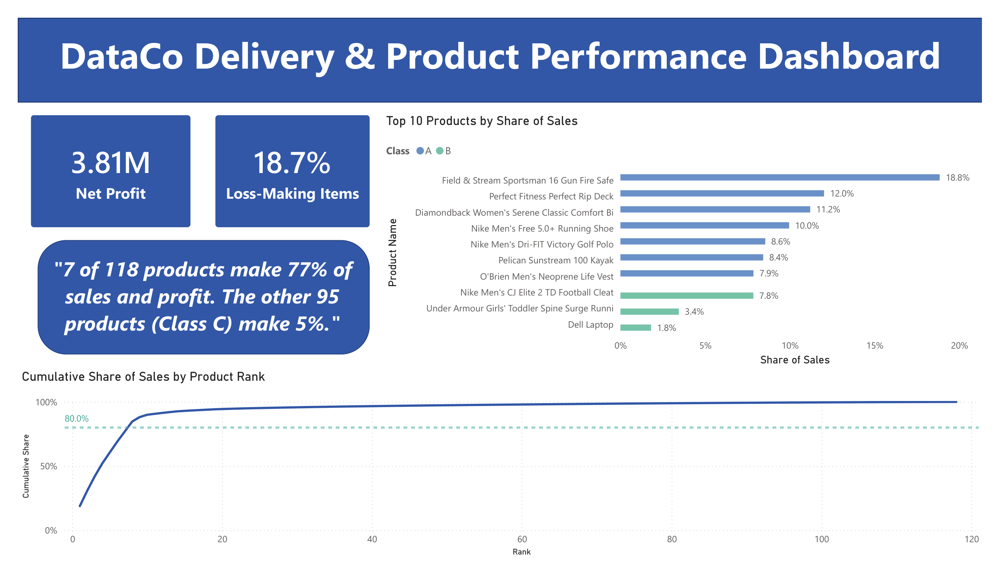

# dataco-delivery-profit-analysis
# Late Delivery and Profit Analysis: DataCo Smart Supply Chain

**Author:** Magda Maurice Bebawy
**Tools:** Python (Pandas), Power BI
**Dataset:** DataCo Smart Supply Chain for Big Data Analysis (public)

## Business question

> Which shipping modes cause the most late deliveries, and what should the company change?

A second part of the project asks where the business loses money and which products matter most.

## Key findings

1. **Lateness comes from unrealistic delivery promises, not from the carrier.** First Class promises 1 day but always takes exactly 2, so it is 100% late. Same Day promises 0 days and takes 0 or 1, so it is 47.9% late. Adding one day to each promise would bring both to 0% late.
2. **Second Class performs like Standard Class.** Both take 2 to 6 days (both average 3.99 days). Second Class promises 2 days and is 79.8% late, and even with one extra day it would still be 59.8% late.
3. **Region does not drive lateness.** Within each shipping mode, late rates are nearly the same in every region.
4. **18.7% of order items lose money**, which cancels about half of the profit earned by profitable items. None of the six factors tested separates loss-making from profitable items.
5. **Sales are highly concentrated.** 7 of 118 products (5.9%) make 76.9% of sales and 76.7% of profit.




## Data

- Source: DataCo Smart Supply Chain for Big Data Analysis, by Constante, Silva and Pereira, published on Mendeley Data (v5, DOI 10.17632/8gx2fvg2k6.5) under CC BY 4.0. A copy is also on Kaggle.
- Raw size: 180,519 rows and 53 columns. Each row is one **order item**, not one whole order (65,752 unique orders, about 2.7 items per order).
- I removed 7,754 items with status `Shipping canceled`, leaving **172,765 items**.
- Personal columns (email, name, password, street) were dropped and are not included in this repository.
- Columns used: `Order Id`, `order date (DateOrders)`, `Shipping Mode`, `Days for shipment (scheduled)`, `Days for shipping (real)`, `Delivery Status`, `Order Region`, `Market`, `Category Name`, `Product Name`, `Sales`, `Benefit per order`, `Order Item Discount Rate`, `Customer Segment`, `Type`.

## Method

**Part 1: Delivery performance**
- Created a late flag: `Days for shipping (real) > Days for shipment (scheduled)`. After removing canceled items it matches the dataset's own `Delivery Status = Late delivery` label exactly (98,977 late items, no disagreements).
- Computed late rates by shipping mode, and by shipping mode and region.
- What-if test: recomputed lateness if every scheduled promise were one day longer.
- Compared profit per item for late and on-time items.

**Part 2: Loss-making items**
- Defined a loss as `Benefit per order < 0`.
- Checked loss rates against lateness, product category, discount rate, customer segment, market and transaction type.
- Confirmed that `Benefit per order` varies between items of the same order, so profit is analyzed at item level and not double-counted.

**Part 3: ABC classification**
- Ranked 118 products by total `Sales`, computed cumulative share, and assigned classes: A up to 80% of cumulative sales, B up to 95%, C the rest. The first product that crosses a cutoff goes into the next class.
- Repeated the ranking using profit to see whether the same products matter.

## Results

### Delivery performance by shipping mode

| Mode | Items | Promised days | Actual days | Late rate | Late rate if promise +1 day |
|---|---|---|---|---|---|
| First Class | 26,513 | 1 | always 2 | 100.0% | 0.0% |
| Same Day | 9,293 | 0 | 0 or 1 | 47.9% | 0.0% |
| Second Class | 33,806 | 2 | 2 to 6 (avg 3.99) | 79.8% | 59.8% |
| Standard Class | 103,153 | 4 | 2 to 6 (avg 3.99) | 39.8% | 20.2% |

The overall late rate is 57.3%. Late rates are nearly identical across regions within each mode. Same Day regional rates rest on small samples (29 to 212 items per region) and are not used for conclusions.

Late items earned slightly less profit than on-time items (mean 21.62 vs 22.58, medians 31.43 vs 31.68). This is an association only.

### Loss-making items

- 32,295 items (18.7%) lose money. Their total loss is 3.71 million profit units, against 7.51 million earned by profitable items.
- No meaningful association with any factor tested:

| Factor | Loss-making | Profitable / overall |
|---|---|---|
| Late rate | 57.4% | 57.3% |
| Average discount rate | 0.102 | 0.102 |
| Loss rate by customer segment | 18.6% to 18.8% | 18.7% overall |
| Loss rate by market | 18.6% to 18.9% | 18.7% overall |
| Loss rate by transaction type | 18.4% to 18.8% | 18.7% overall |

- Category loss rates range from about 19% to 24% among the highest, but the highest ones are small categories with noisy rates, so no category is singled out.

### ABC classification (by sales)

| Class | Products | Share of products | Share of sales | Share of profit |
|---|---|---|---|---|
| A | 7 | 5.9% | 76.9% | 76.7% |
| B | 16 | 13.6% | 18.1% | 18.3% |
| C | 95 | 80.5% | 5.1% | 5.0% |

The top product alone is 18.8% of sales, and the top two together are 30.9%. Sales and profit rankings match closely.

## Recommendations

1. **Reset the delivery promises.** Move First Class from 1 to 2 days and Same Day from 0 to 1 day. In this data that removes nearly all late deliveries without any operational change.
2. **Review Second Class.** It delivers like Standard Class. If it is sold as a premium tier, customers are not getting one, so either speed it up or reposition it.
3. **Do not build region-specific fixes for lateness.** It follows the shipping tier in every region.
4. **Focus attention on the seven A-class products**, and watch the dependency on the top product.
5. **Investigate the cause of losses with cost data.** Lateness, discounts, category, segment, market and transaction type do not explain them, so the answer must lie in data this dataset does not contain.

## Limitations

- The delivery times and profit patterns look **rule-generated** (for example, every First Class item takes exactly 2 days, and Standard Class times are almost evenly spread from 2 to 6 days). This project demonstrates an analysis method on a public dataset, and the findings should not be read as facts about a real company.
- The unit of analysis is the order item, not the order.
- No currency is stated, so profit is reported in "profit units".
- No inventory or product cost columns exist, so ABC classification is based on sales value, not stock, and says nothing about popularity by volume.
- All relationships reported are associations, not proven causes.
- The data does not measure customer satisfaction, so the cost of lateness to customers cannot be assessed.

## Repository structure

```
├── README.md
├── analysis.ipynb          # data cleaning and all analysis
├── dashboard/
│   └── dataco_dashboard.pbix
├── images/
│   ├── dashboard_page1.png
│   └── dashboard_page2.png
└── data/
    └── dataco_clean.csv    # cleaned file without personal columns
```

The raw dataset is not included. Download it from Mendeley Data or Kaggle and place it in the project folder.

## How to reproduce

1. Download the dataset (see Data above).
2. Open `analysis.ipynb` and run all cells. If reading the CSV raises an encoding error, use `encoding="latin-1"`.
3. Open the `.pbix` file in Power BI Desktop, and point it to the cleaned CSV if prompted.

## Credit

Dataset: Constante, F., Silva, F., Pereira, A. (2019). DataCo Smart Supply Chain for Big Data Analysis. Mendeley Data, CC BY 4.0.
